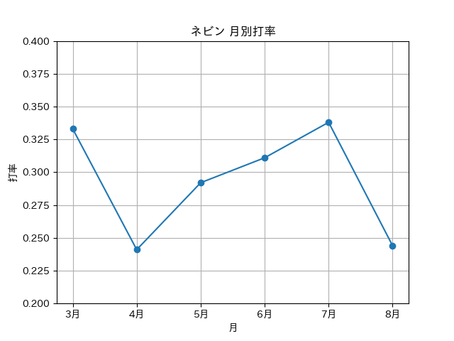
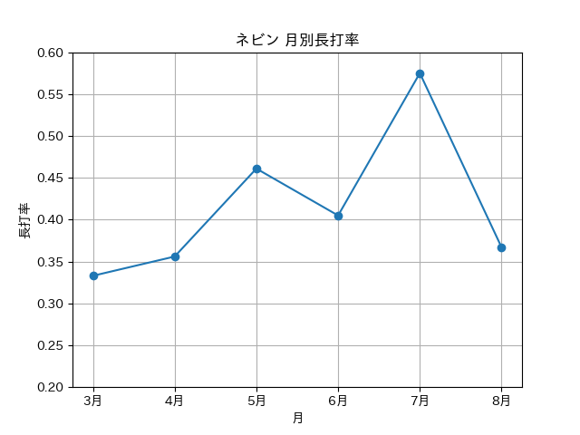
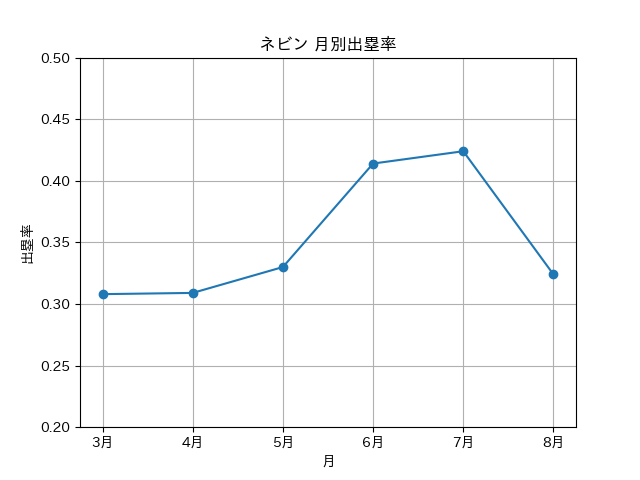

# ネビン選手 月別打撃成績分析

## 分析概要
ネビン選手の月別打撃成績を可視化し、シーズン中の成績推移を分析しました。打率・長打率・出塁率の3指標から、月ごとの打撃成績の変化を確認しています。

## 分析結果・考察

### 月別打率

7月に打率が大きく上昇している一方、8月には低下しており、月ごとに打撃成績の変動が見られた。8月の打率低下は7月の好調からの反動とも考えられる。

### 月別長打率

長打率においても7月に高い数値を記録し、8月に低下する傾向が見られた。打率と同様の推移を示していることから、7月は安打だけでなく長打の面でも好調だったことがうかがえる。

### 月別出塁率

出塁率は7月に上昇し、8月に低下したものの、打率や長打率ほど大きな変動ではなかった。打撃成績が低下した8月においても、安打以外の要素も含めた出塁面では一定の水準を維持していた可能性がある。

## 使用技術
- Python
- pandas
- matplotlib

## データ出典
使用データの取得元については、確認できた情報に基づき記載しています。
