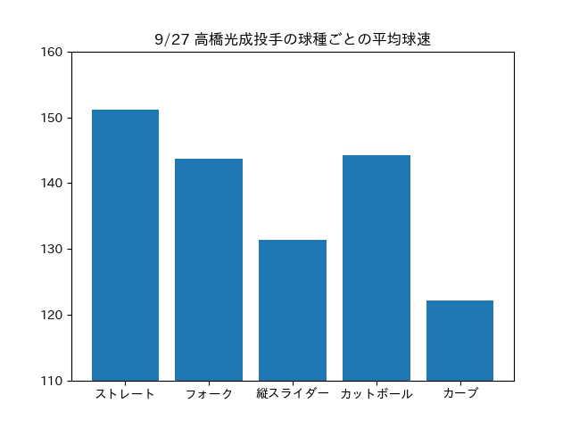
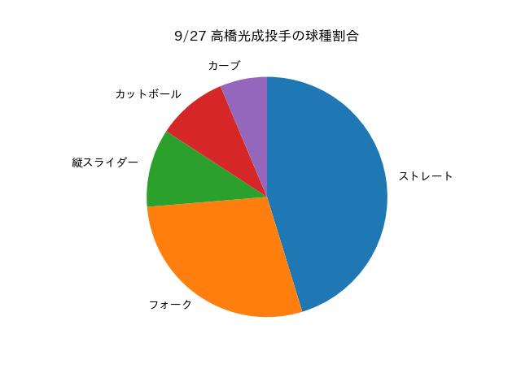
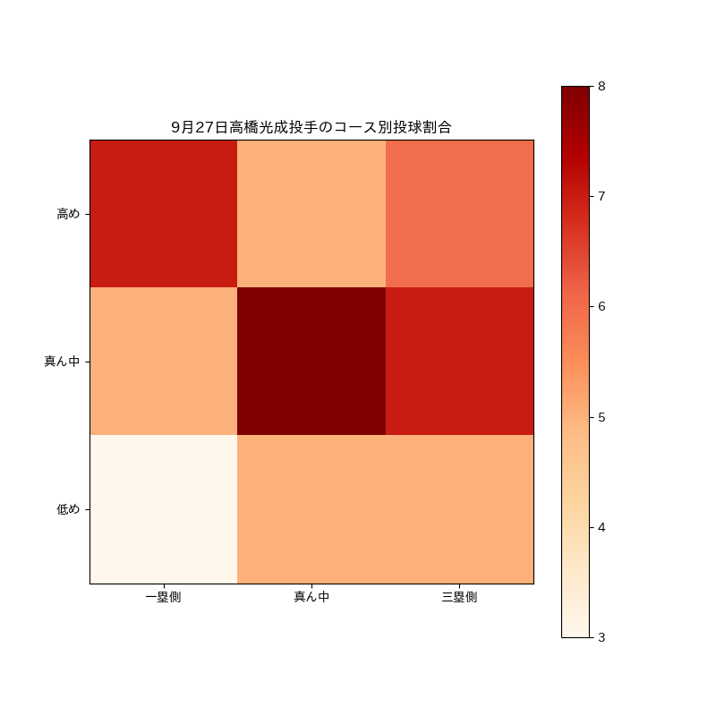
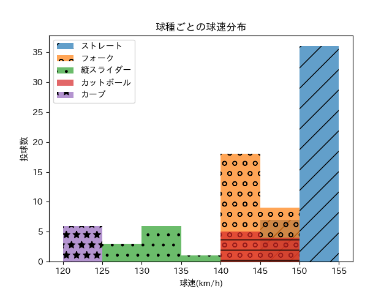
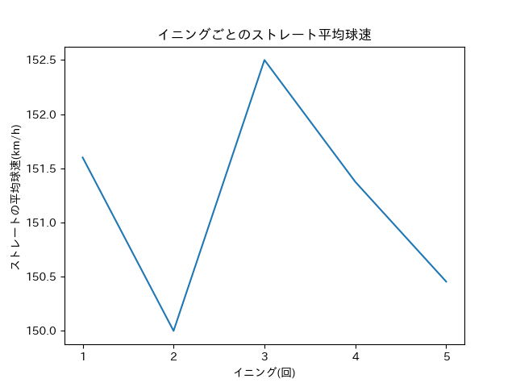

# 高橋光成投手 投球分析（2025年9月27日）

## 分析概要
2025年9月27日の高橋光成投手の登板を対象に、球種割合・球種ごとの平均球速・球速分布・投球コース・イニングごとのストレート平均球速の5項目を分析しました。

現地観戦時に球速を確認し、球種はスポナビアプリで確認しながらGoogleスプレッドシートに記録しました。投球コースについては、投球ごとのデータをスクリーンショットで記録し、集計に使用しました。

## 分析結果・考察

### 1. 球種ごとの平均球速

ストレートの平均球速は約150km/hと最も速く、カーブは約120km/hと最も遅いことが分かりました。また、ストレートとカーブには約30km/hの速度差が見られました。

### 2. 球種割合

この日は5種類の球種を使用しており、ストレートが約50%、フォークが約25%を占めていました。ストレートの割合が最も高く、フォークも比較的多く使用されていたことが分かりました。

### 3. コース別投球割合

投球コースを可視化すると、中央付近への投球が多く、一塁側低めへの投球が少ない傾向が見られました。ヒートマップを用いることで、投球の分布を視覚的に確認することができました。

### 4. 球種ごとの球速分布

球種ごとの球速分布を見ると、縦スライダーは球速の幅が比較的広く、カーブやストレートは球速の変動が比較的小さいことが分かりました。特に縦スライダーは約15km/hの球速差が見られ、球種によって球速の変動幅が異なることが確認できました。

### 5. イニングごとのストレート平均球速

イニングごとのストレート平均球速を見ると、3回が約152.5km/hと最も速く、2回が約150km/hと最も遅いことが分かりました。2回と3回の間には約2.5km/hの差が見られましたが、全体的にイニングごとの平均球速に大きな変動は見られませんでした。事前にはイニングが進むにつれて球速が低下すると予想していましたが、3回に最も速い平均球速を記録しており、予想とは異なる結果となりました。

## 使用技術
- Python
- pandas
- matplotlib

## データ収集方法
- 球速：現地観戦時にバックスクリーンで確認し記録
- 球種：スポナビアプリで確認
- 投球コース：スポナビアプリの投球データをスクリーンショットで記録し集計
- 記録・集計：Googleスプレッドシート

## 参考書籍
『野球データでやさしく学べるPython入門』
