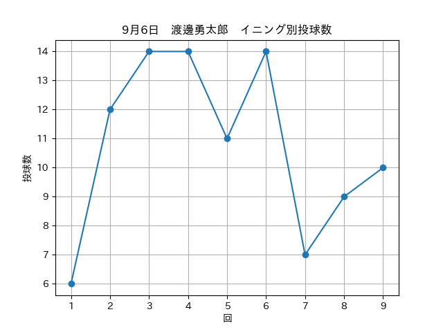
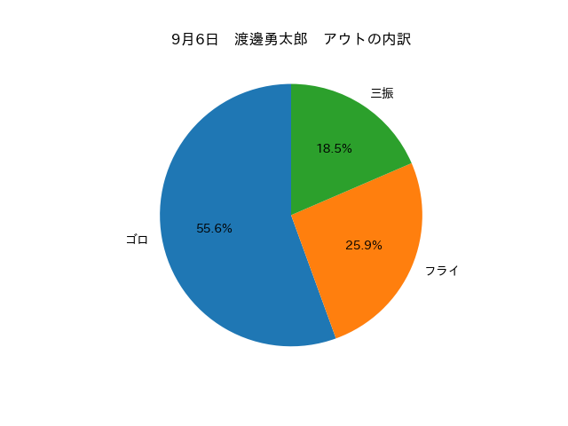

# 渡邊投手 マダックス達成試合の分析

## 分析概要
渡邊投手がプロ初完封・初完投をマダックス（100球未満での完封）で達成した試合を対象に、イニング別投球数とアウトの内訳を可視化し、投球内容を振り返りました。

## 分析結果・考察

### イニング別投球数

イニング別の投球数を見ると、7回以降は投球数が特に少なく、効率的にアウトを取っていたことがうかがえる。試合終盤においても投球数を抑えながら投球を続けており、100球未満で完封を達成するマダックスにつながったと考えられる。

### アウトの内訳

アウトの内訳を見ると、ゴロやフライなど打球によるアウトが多く、打者を効率的に打ち取っていたことがうかがえる。打球によるアウトを積み重ねることで、少ない投球数で試合を終えることにつながったと考えられる。

## 使用技術
- Python
- pandas
- matplotlib

## データ出典
投球データはスポナビアプリの一球速報をもとに、自分で集計しました。
